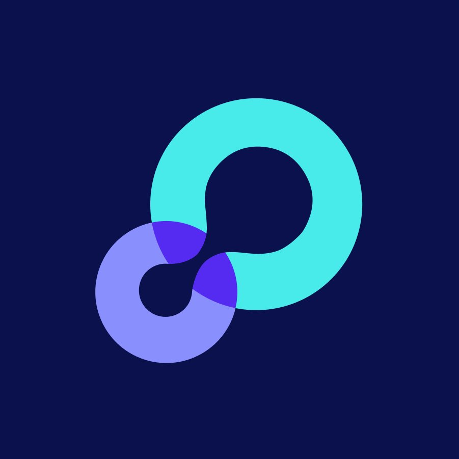

# Felipe Quiroz

### Founder & operator building at the intersection of growth, product and AI.

I build companies, products and systems from **0 → 1**, connecting business, technology and execution.

[Website](https://felipequirozp.cl) · [LinkedIn](https://www.linkedin.com/in/felipequirozp/) · [lowsignal](https://lowsignal.cl)

---

## Currently

### Co-Founder & CEO · [lowsignal](https://lowsignal.cl)

Building a Chilean growth company helping organizations grow across **Education, B2B and B2C**.

We combine strategy, creative, technology, AI and automation to build growth systems — not isolated actions.

**20+ organizations · 5+ industries · 3 verticals**

I lead company strategy, commercial growth, operations, client delivery and the development of our internal products and systems.

---

## Selected work

<table>
<tr>

<td width="33%" valign="top">

### lowsignal

**Co-Founder & CEO**

Building the company from the ground up across positioning, commercial systems, operations, client delivery, team development and new growth products.

**Growth · AI · Operations · Company Building**

[Visit lowsignal →](https://lowsignal.cl)

</td>

<td width="33%" valign="top">

### GeoVictoria

**Product Manager**

Led discovery, validation and product development across workforce-management solutions including **Smart Scheduler, Shift Optimizer and Shift Change Workflow**.

Worked directly with customers across Latin America to turn complex operational problems into scalable product experiences.

**B2B SaaS · Product · Workforce Tech**

</td>

<td width="33%" valign="top">

### Tether Education

**Head of Partnerships**

Led partnerships, business development and market expansion across **Latin America, the U.S. and Europe** for a U.S.-based AI-enabled EdTech and GovTech company.

Worked across an ecosystem of **600+ institutions in 7 markets**, connecting product, technology and education.

**EdTech · GovTech · AI · Partnerships**

</td>

</tr>
</table>

---

## Selected projects

A few deeper dives into products and systems I've helped build.

<table>
<tr>

<td width="50%" valign="top">

### lowsignal Workspace

Building the internal operating layer behind a growing company — bringing commercial activity, delivery, operations and internal workflows into one place
